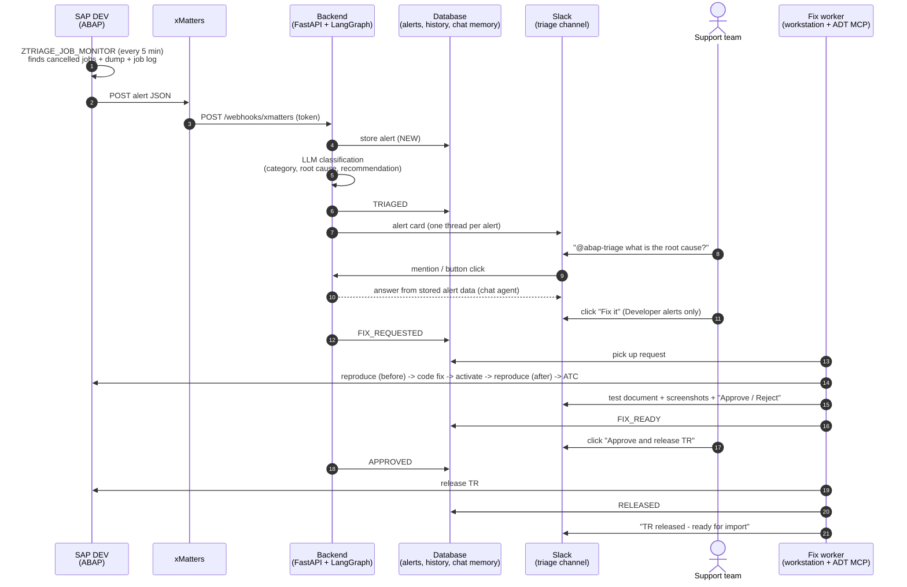
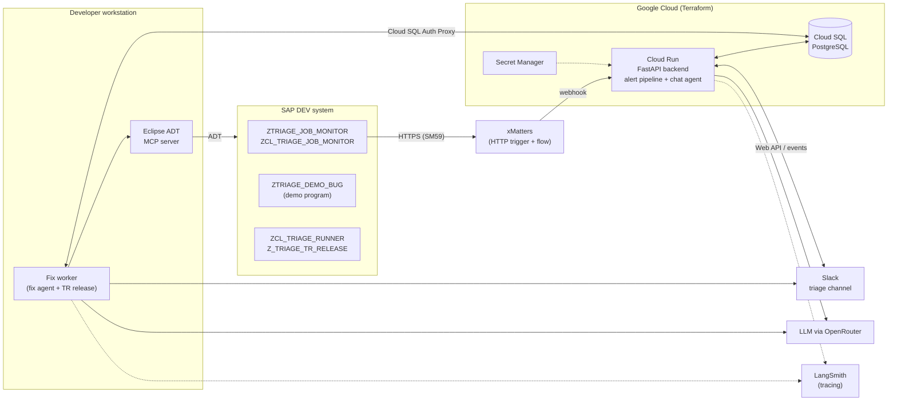
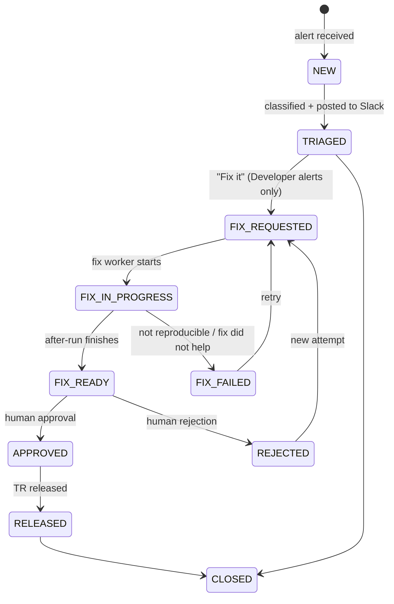

# Simple ABAP Triage

AI-assisted triage for failed SAP background jobs. When a job is cancelled in SAP (for example by an ABAP short
dump), the system:

1. **detects** the cancelled job in SAP and sends its details (program, variant, job log, dump) to **xMatters**,
2. **classifies** the incident with an LLM: who should handle it (**Developer** = program bug, **Functional** = data
   issue, **Basis** = system / connection issue), the **root cause** and a **recommendation**,
3. **posts** an alert card to a **Slack** channel, where the team can ask the AI about the alert in its thread,
4. on request, lets a **fix agent** reproduce and fix a program bug in the SAP DEV system, and upload a **test
   document** (RCA, code diff, before/after screenshots) to the thread,
5. after a human **approval** in Slack, **releases the transport request (TR)** for import into the next environment.

Humans stay in control: the AI never releases a transport without an explicit approval, and the fix agent only
changes the custom program named in the alert.

> Scope: an MVP built step by step (see [`PLAN.md`](PLAN.md) for phases and success checklists).

---

## Workflow



### Architecture



Why the fix worker runs on a workstation: the SAP ADT MCP server runs inside Eclipse and is only reachable on the
local machine, logged on to SAP DEV. Cloud Run never connects into the company network; the worker only makes
outbound connections (Cloud SQL, Slack, LLM, local MCP).

### Alert status lifecycle



Every transition is validated in code and logged with actor and timestamp (`alert_events`).

---

## Technology stack

| Area | Technology | Used for |
|---|---|---|
| Source system | **SAP ABAP** (S/4HANA DEV) | Demo program, job monitor, runner, TR release (function module) |
| SAP access for the AI | **Eclipse ADT MCP server** + `langchain-mcp-adapters` | Read / edit / check / activate code, run ABAP Unit, ATC, transports |
| Alerting | **xMatters** | Receives SAP alerts (HTTP trigger), forwards them to the backend webhook |
| Backend | **Python 3.12**, **FastAPI**, Uvicorn | Webhook, Slack endpoints, background processing |
| Agent framework | **LangGraph** (`StateGraph`) | Deterministic alert pipeline: store → classify → post |
| | **LangChain `create_agent`** | Chat agent (Slack Q&A + actions) and fix sub-agent (guarded ADT tools) |
| LLM | **OpenRouter** (OpenAI-compatible API, model configurable) | Classification (structured output), chat, code fix, RCA |
| Chat | **Slack** app (`slack_bolt`, Block Kit) | Alert cards, threads, buttons, file upload; Socket Mode locally, HTTP on Cloud Run |
| Database | **SQLAlchemy**; SQLite locally, **Cloud SQL PostgreSQL** in GCP | Alerts, status history; LangGraph checkpointer for chat memory per thread |
| Observability | **LangSmith** | Traces of pipeline, chat agent and fix agent runs |
| Cloud | **Google Cloud**: Cloud Run, Cloud SQL, Secret Manager, Artifact Registry | Hosting the backend |
| Infrastructure as code | **Terraform** | All GCP resources (with a `paused` toggle to save cost) |
| Reports | Pillow, HTML | Test document and before/after "screenshots" of the job output |
| Tooling | `uv`, pytest | Dependencies, unit and live tests |

### Design choices
- **LangGraph vs `create_agent`:** the alert pipeline must be deterministic, so it is a small fixed LangGraph graph
  with a single structured-output LLM step. Open-ended work (chatting, fixing code) uses `create_agent`.
- **Approval and release are code, not AI decisions:** status rules are enforced in one place (`app/actions.py`,
  `app/status.py`) for buttons and chat alike.
- **Guarded fix agent:** only the alert's custom (Z/Y) program, the transport chosen by the worker, a limited
  number of edits, activation only after a clean syntax check. A fix only counts if the reproduce run finishes.
- **Reproducing via ABAP Unit:** the ADT MCP cannot run programs, but it can run unit tests. A local helper class
  runs the program + variant as a real background job and reports status, job log, list output and dump.
- **Fallbacks:** if the LLM is unavailable, alerts are classified by rules and the bot answers with stored data.
- **No private data in the repository:** system ids, transports, project ids, tokens live only in git-ignored
  `.env` / `terraform.tfvars` / `backend.hcl` (key list: [`.env.example`](.env.example)).

---

## Repository layout

```
ABAP/                 copies of all ABAP objects created in SAP (abapGit-style file names)
app/
  main.py             FastAPI app: /webhooks/xmatters, /slack/events, /slack/interactions, /health
  pipeline/           LangGraph alert pipeline + classifier (LLM + rule fallback)
  agents/             chat agent (create_agent + DB tools, memory per Slack thread)
  fix/                fix worker: ADT MCP gateway, reproduce (evidence), fix agent, report, TR release
  chat/               ChatClient interface, Slack client + Block Kit cards, fake client for tests
  actions.py          fix / approve / reject rules (shared by buttons and chat)
  db.py, status.py    persistence and status lifecycle
infra/terraform/      GCP infrastructure (Cloud Run, Cloud SQL, Secret Manager, Artifact Registry)
docs/                 xMatters payload contract, Slack setup + app manifest, runbook
scripts/              smoke tests (OpenRouter, ADT MCP), send a test alert
tests/                unit tests (offline) and live tests (-m live)
```

## Getting started (local)

Prerequisites: `uv`, a filled `.env` (see [`.env.example`](.env.example)), a Slack app
([`docs/slack-setup.md`](docs/slack-setup.md)), and for fixes Eclipse with the ADT MCP server logged on to SAP DEV.

```bash
uv sync                                        # install dependencies
uv run pytest                                  # unit tests (no external calls)
uv run uvicorn app.main:app --port 8000        # backend (Slack Socket Mode)
uv run python -m app.fix.worker                # fix worker (second terminal)
uv run python scripts/send_alert.py div0 --new-id   # send a test alert like xMatters would
```

More: [`docs/runbook.md`](docs/runbook.md) (local operation), [`infra/terraform/README.md`](infra/terraform/README.md)
(GCP deploy, pause, destroy), [`docs/xmatters-contract.md`](docs/xmatters-contract.md) (alert payload).

## Status

| Phase | Content | Status |
|---|---|---|
| 1 | SAP: demo program, job monitor → xMatters, runner, TR release | done (alerts received in xMatters) |
| 2 | Slack integration (cards, threads, buttons, Socket Mode) | done locally; HTTP mode after deploy |
| 3.1–3.2 | Alert pipeline + classification | done (3/3 demo alerts correctly classified) |
| 3.3 | Chat agent in Slack threads | done |
| 3.4 | Fix agent with test document | done (live fix in DEV: before dump, after finished) |
| 3.5 | Approval + TR release | built; live release pending approval |
| – | Deploy to GCP (Terraform + Cloud Run) | infrastructure code ready, not applied |

Details and checklists: [`PLAN.md`](PLAN.md).
